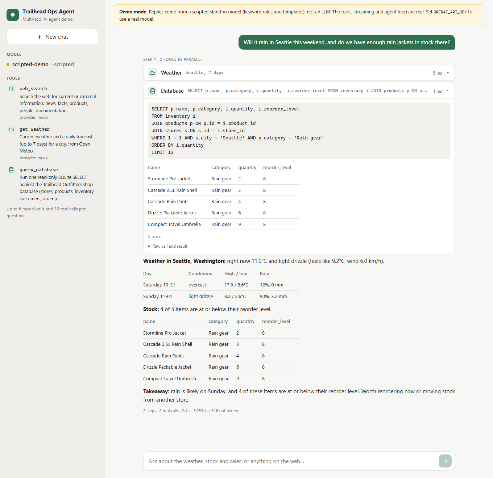
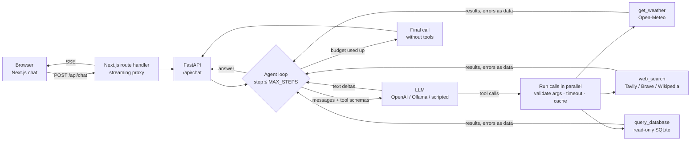

# Multi-tool AI Agent

A Python agent that answers questions by calling tools (web search, a weather API and a SQL database), with a Next.js chat UI that shows every tool call as it happens.

A chatbot on its own can't answer "will it rain in Seattle this weekend, and do we have enough rain jackets there?". It doesn't know the forecast, and it has never seen the shop's stock levels. This project gives the model **three tools** and an **agent loop** that lets it decide what to call. Independent lookups run **in parallel**. When one answer depends on another ("which store sold the most last month, and what's the weather *there*?"), the loop runs them **in sequence**. The model writes the SQL itself, so the database tool is locked down at several levels: read-only file access, an authorizer that refuses anything but reads, a query timeout and a row cap. Web results are labelled as untrusted, so instructions planted in a page aren't followed. The UI streams the answer token by token, with expandable cards showing each call's arguments, SQL, result table and timing.



*The screenshot is from a real run of the full stack: the Next.js UI, the agent API and its tools, against the bundled mock services. No OpenAI key was available, so the replies come from the **scripted demo model** (keyword rules and answer templates, [see below](#the-scripted-demo-model)), not from an LLM. The agent loop, streaming, tool execution, SQL and UI are the same code a real model would use.*

## How it works



**The agent loop** ([toolagent/agent.py](toolagent/agent.py))

- Each user turn is a loop of streamed chat-completion calls. If the model asks for tools, they run, their results go back into the conversation, and the model is called again. When the model answers without tools, the turn ends.
- **Parallel calls.** All tool calls from one step start at once (`asyncio`). Results stream to the UI as each one finishes, but they go back to the model in the order it asked for them.
- **Errors are data.** Invalid JSON arguments, a failed pydantic validation, an unknown tool name, a timeout or an upstream outage become a tool result like `{"error": "No place called 'Atlantis' was found…"}`, so the model can fix its arguments and retry, or explain what it couldn't check. A crashing tool is logged, and the model only hears "internal error".
- **Budgets.** `MAX_STEPS` caps model calls per turn, and `MAX_TOOL_CALLS` caps tool calls. When either runs out, the last call is made **without tools** and with an instruction to answer from what it has. Calls over the budget get a "skipped" result, so every call still has a matching result. An identical call repeated within a turn (small models do this) is answered from a cache.
- **Context size.** Tool output is cut to `MAX_TOOL_RESULT_CHARS`. Lists such as rows and search results are halved first, so the JSON stays valid. Older turns are dropped once the history passes `MAX_HISTORY_CHARS`, always as whole turns, so an assistant tool call is never separated from its results (the API rejects that).
- **Rollback.** If the LLM fails mid-turn, or the client disconnects (the Stop button), everything the turn added is removed from the session and running tools are cancelled.
- **Streaming quirks.** Tool-call fragments are merged by `index`, and a new id at a reused index starts a new call. Some OpenAI-compatible servers send each call whole with index 0.

**The tools** ([toolagent/tools/](toolagent/tools/)). Each tool declares a pydantic argument model. Its JSON schema becomes the function definition sent to the model, and incoming arguments are validated against the same model.

| Tool | What it calls | Notes |
| --- | --- | --- |
| `get_weather` | [Open-Meteo](https://open-meteo.com) geocoding + forecast (free, no key) | Accepts `"Portland, Maine"`, `"Paris, TX"` or `"London, UK"`, matching country, state, state abbreviation or region. With a bare name it picks the most populous match and lists the alternatives. Returns weekdays in local time, so "this weekend" is easy for the model. Metric or imperial. |
| `web_search` | Tavily, Brave Search, or Wikipedia (keyless) | Results get source ids that are unique across the whole turn, and the model cites them as `[1]`. HTML is stripped from snippets, and non-http URLs are dropped. Output reaches the model wrapped as `untrusted_content` with a note to ignore instructions inside. |
| `query_database` | The bundled SQLite shop database | The schema (with foreign keys and notes such as "revenue counts only completed orders") is written into the tool description at startup, so the model can write joins without an extra round trip. |

**SQL safety** ([toolagent/tools/database.py](toolagent/tools/database.py)). The model writes arbitrary SQL, so several independent guards apply:

1. The file is opened with `mode=ro`, so SQLite itself refuses writes.
2. `PRAGMA query_only` is turned on for the connection.
3. An **authorizer callback** allows only `SELECT`, column reads, recursive CTEs and functions. `ATTACH`, `INSERT`/`UPDATE`/`DELETE`, DDL, transactions, `VACUUM INTO`, `load_extension` and every pragma except five read-only ones (`table_info` and similar) are refused when the statement is compiled.
4. A **progress handler** aborts queries that run longer than `QUERY_TIMEOUT_MS` (recursive CTEs, cross joins), and `SQLITE_LIMIT_LENGTH` caps the size of any single value.
5. `sqlite3` runs only one statement per call, so `SELECT 1; DROP TABLE …` fails.
6. Results are capped at `MAX_QUERY_ROWS`, with a `truncated` flag and a hint to aggregate.

The tests try each of these, and check that the file is unchanged afterwards.

**API** ([toolagent/api.py](toolagent/api.py)). `POST /api/chat` takes `{message, session_id?}` and returns `text/event-stream` with these events: `turn_start`, `step`, `text`, `tool_call`, `tool_result`, `done` (sources, token usage, steps, timing) and `error`. Sessions are in memory with a TTL and an LRU cap. A second message to a session that is still answering gets `409`. `GET /api/tools` lists the tool schemas and the active model, and the docs are at `/api/docs`.

**UI** ([web/](web/)). Next.js 16 App Router and React 19.

- A route handler proxies the stream to the browser without buffering. It passes the request's abort signal upstream, so Stop really stops the turn on the server.
- Tool calls from the same step are grouped as "N tools in parallel". Each card shows its arguments, timing and status, and expands to show the SQL, a result table, the forecast or the search hits, plus the raw JSON.
- Answers render as Markdown (GFM tables) with no raw HTML, and `[n]` citations become links to their sources.
- Dark mode is supported, and the layout works at phone width.

## Tech stack

- Python 3.12, asyncio
- OpenAI Python SDK (streaming chat completions with tool calling). Works with OpenAI or any compatible server (Ollama, LM Studio, vLLM).
- FastAPI, Uvicorn and server-sent events
- pydantic and pydantic-settings for tool schemas, validation and config
- httpx for Open-Meteo, Tavily, Brave and Wikipedia
- SQLite (stdlib `sqlite3`) with an authorizer callback
- Next.js 16, React 19, TypeScript, react-markdown + remark-gfm, plain CSS
- Docker Compose (web, agent, mock services)
- Tests: 122 pytest tests with no network or API keys (a fake LLM via `httpx.MockTransport`, and the mock services mounted in-process via `httpx.ASGITransport`), plus 18 Vitest tests for the SSE parser and the UI state reducer

## Run it

### Docker

```bash
cp .env.example .env        # optional: add OPENAI_API_KEY; without it the scripted demo model answers
docker compose up --build
```

- **Chat UI:** http://localhost:3000
- **Agent API:** http://localhost:8000/api/docs
- **Mock services:** http://localhost:8100/docs

The defaults use the real Open-Meteo and Wikipedia APIs (both free, no key). For a fully offline run, set `SEARCH_PROVIDER=mock` and `WEATHER_PROVIDER=mock` in `.env`.

### Locally

```bash
python -m venv .venv
source .venv/bin/activate                     # Windows: .venv\Scripts\activate
pip install -r requirements-dev.txt
cp .env.example .env

python -m mock_services                        # terminal 1: scripted model + fake APIs on :8100
python -m toolagent serve                      # terminal 2: agent API on :8000 (builds data/shop.db on first start)

cd web && npm install && npm run dev           # terminal 3: http://localhost:3000
```

`python -m mock_services` is only needed when no LLM is configured, or when a `*_PROVIDER` is set to `mock`. The agent also has a terminal client:

```bash
python -m toolagent chat                       # interactive; tool calls are printed as they run
python -m toolagent chat "Which store had the most sales last month?"
python -m toolagent tools                      # the exact tool schemas sent to the model
python -m toolagent seed-db                    # rebuild the demo database
```

### With a real model

```bash
# OpenAI
OPENAI_API_KEY=sk-...          OPENAI_MODEL=gpt-4.1-mini

# Ollama (pick a model with tool-calling support)
OPENAI_BASE_URL=http://localhost:11434/v1   OPENAI_MODEL=llama3.1:8b
```

### Tests and tooling

```bash
pytest                                         # 122 tests, no network or API key needed
cd web && npm test                             # 18 Vitest tests
cd web && npm run typecheck && npm run build
python scripts/make_screenshot.py              # regenerate docs/screenshot.png from the running stack (needs Playwright)
```

## Things to ask

| Question | What happens |
| --- | --- |
| Will it rain in Seattle this weekend, and do we have enough rain jackets in stock there? | `get_weather` and `query_database` in parallel, then one answer that combines them |
| Which store had the most sales last month, and what's the weather there tomorrow? | Two steps: the SQL result decides which city's weather to fetch |
| What are the best-selling products in Denver over the last 30 days? | One aggregate query with joins |
| What's the latest on PFAS-free rain jackets? | Web search with numbered citations. With the mock search, one result is a planted prompt injection. |
| What's the weather in Portland? | Picks Portland, Oregon, and mentions Portland, Maine |

## The demo database

[toolagent/demo_db.py](toolagent/demo_db.py) builds a made-up outdoor-gear chain, Trailhead Outfitters: 6 stores, 22 products, stock levels, 400 customers and a year of orders (about 4,000). The data is random but seeded, so the same seed and date give the same database. Sales follow the seasons and each store's climate, so rain gear sells in Seattle in autumn, parkas in Minneapolis in winter and sandals in Austin in summer. Seattle is nearly out of rain gear. Dates are relative to the day the database is built, so "last month" always has data.

## The mock services

[mock_services/](mock_services/) is one FastAPI app that speaks the real protocols, so the agent uses its normal clients and only base URLs change:

- **Tavily** `POST /tavily/search`: keyword search over 12 made-up articles on `example.*` domains, one of which is a prompt-injection attempt.
- **Open-Meteo** `/open-meteo/geocoding/v1/search` and `/open-meteo/forecast/v1/forecast`: the same response shape and unit parameters as the real API, for a small gazetteer that includes ambiguous names (two Portlands, two Parises, three Springfields, two Londons). The weather is invented but deterministic per place and day, and Seattle is reliably wet.
- **The scripted model** at `POST /v1/chat/completions`, covered below.

### The scripted demo model

[mock_services/scripted_llm.py](mock_services/scripted_llm.py) **is not a language model.** It's an OpenAI-compatible endpoint (streaming and non-streaming, tool calls in fragments, usage chunks) whose "reasoning" is a set of keyword rules: weather words plus a place name call `get_weather`, stock and sales words become one of a few SQL templates, and question words call `web_search`. After the tool results come back, it fills Markdown templates from them. It can do a two-step plan (a city from a SQL result, then that city's weather), and it says when it skipped a search result that contains instructions.

It exists so that the agent loop, streaming, parallel calls, the UI and Docker can all be run and tested without an API key. It handles the example questions and close variations. Anything else gets a polite "I only follow simple rules" reply, and the UI shows a **Demo mode** banner whenever it's in use.

## Configuration

All settings come from environment variables or `.env` ([.env.example](.env.example)).

| Variable | Default | Purpose |
| --- | --- | --- |
| `OPENAI_API_KEY` / `OPENAI_MODEL` | empty / `gpt-4.1-mini` | OpenAI credentials and model |
| `OPENAI_BASE_URL` | empty | Any OpenAI-compatible server. Without it and without a key, the scripted model at `DEMO_LLM_URL` is used. |
| `DEMO_LLM_URL` | `http://127.0.0.1:8100/v1` | Where the scripted model lives |
| `SEARCH_PROVIDER` | `auto` | `auto` (Tavily if keyed, else Brave if keyed, else Wikipedia), `tavily`, `brave`, `wikipedia`, `mock` |
| `TAVILY_API_KEY` / `BRAVE_API_KEY` | empty | Search API keys |
| `WEATHER_PROVIDER` | `open-meteo` | `open-meteo` or `mock` |
| `MOCK_SERVICES_URL` | `http://127.0.0.1:8100` | Base URL for the `mock` providers |
| `DB_PATH` | `data/shop.db` | SQLite file, built on first start if missing |
| `MAX_STEPS` / `MAX_TOOL_CALLS` | 6 / 12 | Model calls and tool calls per user turn |
| `TOOL_TIMEOUT_SECONDS` | 20 | Per tool call |
| `MAX_TOOL_RESULT_CHARS` / `MAX_HISTORY_CHARS` | 6000 / 40000 | What the model sees per tool result, and in total |
| `MAX_QUERY_ROWS` / `QUERY_TIMEOUT_MS` | 100 / 2000 | SQL result cap and time limit |
| `LLM_TIMEOUT_SECONDS` / `LLM_MAX_RETRIES` | 60 / 2 | Per LLM call. The SDK retries 429 and 5xx. |
| `TEMPERATURE` / `MAX_OUTPUT_TOKENS` | 0.2 / 1200 | Sampling settings |
| `SESSION_TTL_MINUTES` / `MAX_SESSIONS` | 60 / 500 | In-memory conversation store |
| `CORS_ORIGINS` | `http://localhost:3000,…` | Only for calling the API directly from a browser. The web app goes through its own proxy. |
| `AGENT_API_URL` (web) | `http://127.0.0.1:8000` | Where the Next.js server finds the agent API |

To add a tool, subclass `Tool` in [toolagent/tools/](toolagent/tools/) with a pydantic `Args` model, a `description` and an async `run()`, and add it to `build_tools()`. Raise `ToolError` for failures the model should hear about. Set `untrusted = True` if its output comes from third parties.

## Limitations

- **Not yet run against a real LLM.** No OpenAI key was available, and the local Ollama server wasn't running when this was built. Everything below the model is tested and was run live: the real Open-Meteo and Wikipedia APIs were called through the agent and the full stack ran in the browser. But the screenshot and the example answers come from the scripted model, so the quality of real-model answers, SQL included, is unmeasured. Small local models in particular may call tools poorly.
- **The model writes SQL, and SQL can be wrong.** The guards stop it from changing anything or running away. They don't stop a query that runs fine and answers the wrong question (for example, forgetting `status = 'completed'`). The UI shows the SQL so a person can check.
- **Prompt injection is reduced, not solved.** Search results are labelled untrusted and the system prompt says to ignore instructions in them. None of the tools can send data anywhere or change anything, which limits the damage. A determined injection could still bias an answer.
- **Sessions live in memory.** They're lost on restart and aren't shared between API replicas. Redis or a database would fix that.
- **No authentication or rate limiting.** It's a demo. Anyone who can reach the API can spend your LLM and search credits.
- **Docker is untested.** The compose file and both images were written but not built here (no Docker on the build machine). The pieces they run were tested directly, including the Next.js standalone server.
- **Turbopack builds weren't verified here.** The local sandbox blocked Turbopack's cache files, so the web app was verified with `next build --webpack`. `npm run build` uses Next 16's default (Turbopack), which is what the Dockerfile runs.

All stores, products, customers, orders, articles and forecasts in the demo data are made up.

## sort entries

Updated implementation details.

## format output

Updated implementation details.